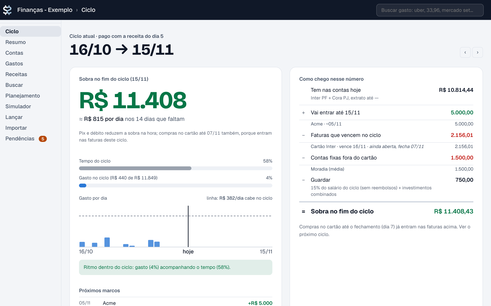
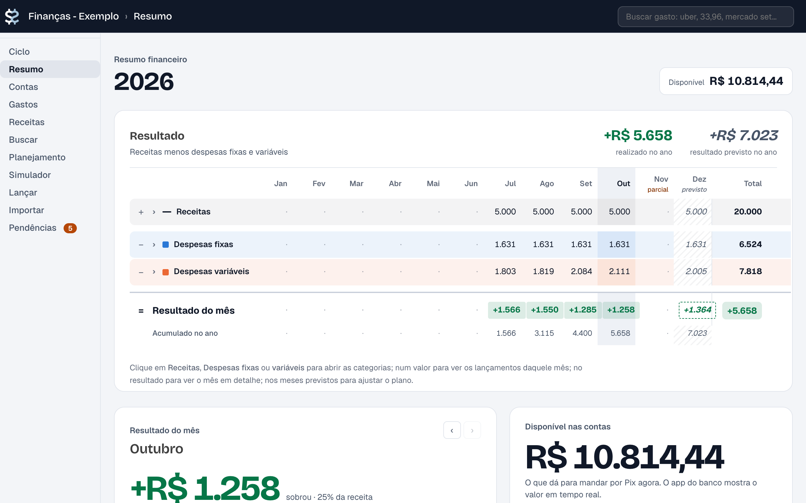
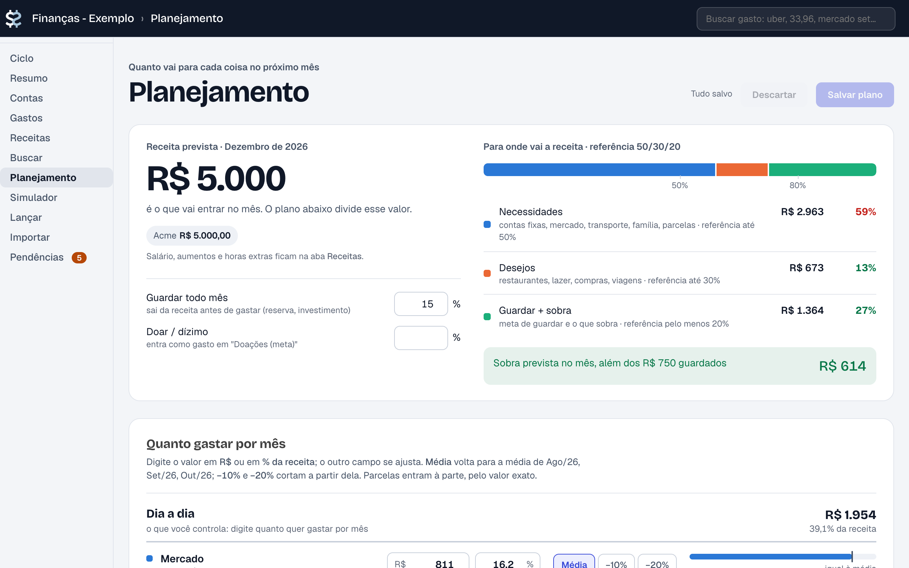
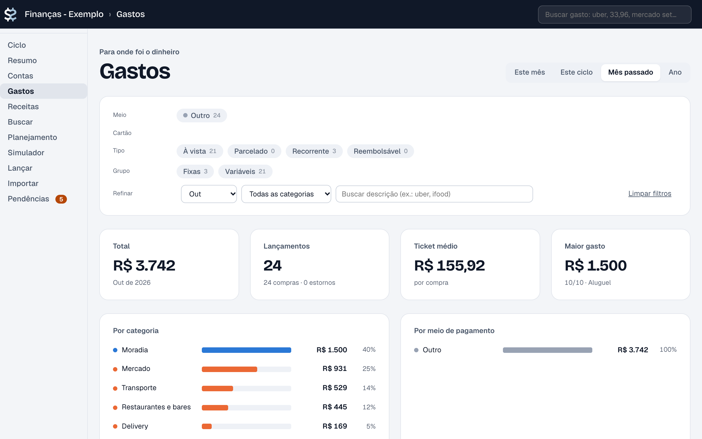

# finance

> **English:** Personal and MEI (Brazilian sole-proprietor) finance tracker that runs locally on macOS, built on [Beancount](https://beancount.github.io/docs/) + [Fava](https://beancount.github.io/fava/). Imports statements from Brazilian banks (Inter, Nubank, Cora, any OFX). The UI and docs are in Portuguese.

**Controle financeiro pessoal e de MEI que roda no seu Mac.** Você baixa os extratos do banco e arrasta para o painel. O sistema categoriza tudo e mostra quanto sobra até o fim do mês, para onde foi o dinheiro e como ficam os próximos meses.

**[Veja a demo →](https://finance-demo.iagobragas.com.br)** com dados fictícios, somente leitura. Para usar com os seus extratos, rode localmente (é o que mantém seus dados só no seu computador).

- 🔒 **100% local:** seus dados nunca saem do seu computador. Não tem conta, nuvem nem login no banco.
- 🧾 **Lê os arquivos que o banco já te dá:** Inter, Nubank, Cora e qualquer banco que exporte OFX.
- 📅 **Pensa em ciclos de cartão:** mostra o que já está comprometido nas próximas faturas, as parcelas e as assinaturas.
- 🧮 **Contabilidade de verdade:** feito com [Beancount](https://beancount.github.io/docs/) (partidas dobradas) e [Fava](https://beancount.github.io/fava/). Os saldos são conferidos com os extratos.



<table>
<tr>
<td></td>
<td></td>
<td></td>
</tr>
<tr>
<td align="center">Resumo do ano</td>
<td align="center">Planejamento</td>
<td align="center">Gastos</td>
</tr>
</table>

<sub>As imagens usam os dados fictícios de <code>exemplo/</code>.</sub>

---

## Comece em 2 minutos

Precisa de um Mac com [Homebrew](https://brew.sh).

```sh
brew install uv poppler git
git clone https://github.com/iagobragas/finance.git
cd finance
./finance exemplo
```

O painel abre em **http://localhost:5050** com dados fictícios, para você explorar. Para abrir em outro navegador ou em janela anônima, defina `FINANCE_BROWSER`, por exemplo `export FINANCE_BROWSER='open -na "Google Chrome" --args --incognito {url}'`. Na primeira vez, o `./finance` baixa o Python e instala as dependências sozinho (com o [uv](https://docs.astral.sh/uv/), nas versões travadas em `uv.lock`), o que leva menos de um minuto. Para sair, use `Ctrl+C`.

### Usar com os seus dados

```sh
./finance init      # cria a pasta dados/ com configurações de exemplo e um livro vazio
```

1. Em `dados/config/accounts.yaml`, coloque suas contas, os cartões (dia de fechamento e de vencimento), as empresas que pagam você e o dia do pagamento.
2. Em `dados/config/rules.yaml`, ajuste as regras de categoria e ponha o seu nome e CNPJ na regra de "transferência para você mesmo".
3. Rode `./finance` e arraste os extratos na aba **Importar**.
4. Na aba **Pendências**, categorize o que ficou sem regra. Cada escolha pode virar uma regra nova.
5. Na aba **Planejamento**, defina o salário, quanto gastar por categoria e quanto guardar.

---

## O dia a dia

```sh
./finance           # importa, confere e abre o painel; reimporta sozinho quando algo muda
./finance check     # só confere se os saldos batem com os extratos
```

**Uma vez por mês, ou quando quiser:** baixe os extratos e arraste na aba **Importar**, ou jogue em `dados/inbox/`. O sistema:

- reconhece o banco e o período, renomeia e guarda o arquivo;
- ignora arquivos repetidos;
- **não duplica lançamentos** quando dois extratos cobrem os mesmos dias.

Dinheiro vivo, empréstimo e outras coisas que não aparecem em extrato vão pela aba **Lançar**.

### As abas

| Aba | Para que serve |
|---|---|
| **Ciclo** | Quanto sobra até o fim do ciclo (ex.: dia 16 a 15), com o que ainda entra, as faturas, assinaturas, parcelas e DAS. Mostra também os próximos ciclos até a última parcela |
| **Resumo** | O ano mês a mês: receitas, despesas fixas, variáveis e resultado |
| **Contas** | Extrato de cada conta e cartão, com saldo e comprovantes |
| **Gastos** | Todos os gastos com filtros. Permite marcar o que a empresa vai reembolsar |
| **Receitas** | Quanto entrou de cada fonte, o limite do MEI, as notas fiscais e os reembolsos a receber |
| **Buscar** | Busca livre: `uber > 30`, `mercado set` |
| **Planejamento** | Orçamento 50/30/20, quanto gastar por categoria (em R$ ou em %), metas e a previsão dos próximos meses |
| **Simulador** | E se eu tiver um aumento? E se eu cortar restaurante? |
| **Lançar** | Lançamento manual rápido, com a categoria sugerida |
| **Importar** | Arraste os arquivos. Mostra o que está atrasado e como baixar cada um |
| **Pendências** | O que falta categorizar ou conferir |

---

## Bancos suportados

| Fonte | Arquivo | Onde baixar |
|---|---|---|
| Conta Inter PF | CSV | App Inter → Extrato → Exportar → CSV |
| Cartão Inter | CSV ou PDF | App Inter → Cartão → Fatura → Exportar CSV (dá para baixar a fatura aberta) |
| Cartão Nubank | OFX ou CSV | App Nubank → Fatura → Exportar OFX |
| Conta Nubank PF | OFX | App Nubank → Conta → Extrato → Exportar OFX |
| Conta Cora PJ | OFX ou CSV | App/Web Cora → Extrato → Exportar |
| **Qualquer banco com OFX** | OFX | Basta cadastrar o número da conta em `ofx_contas` no `accounts.yaml` |
| NFS-e do MEI | XML | Emissor nacional → Notas emitidas |

Outro banco em CSV ou PDF precisa de um leitor novo. Veja [Contribuir](#contribuir).

---

## Privacidade: código e dados separados

Este repositório tem **só o código** e um exemplo fictício. Os seus dados ficam na pasta `dados/`, que **nunca** vai para o git (está no `.gitignore`):

```
dados/
  config/        suas configurações (contas, regras, plano, reembolsos)
  ledger/        o livro contábil (main, imported gerado, manual)
  statements/    os extratos, organizados automaticamente
  inbox/         onde chegam os arquivos novos
  comprovantes/  fotos e PDFs de comprovantes
  notas/         notas fiscais emitidas
```

A pasta é procurada em `$FINANCE_DATA` e, se a variável não existir, em `dados/` ao lado do código. Ela pode ser um link para outra pasta.

Se você for contribuir com código, ative a verificação que bloqueia commits com extratos, CPF ou CNPJ:

```sh
git config core.hooksPath .githooks
```

---

## Usar em mais de um Mac (iCloud)

O código vai pelo git e os dados pelo iCloud Drive.

**No Mac onde os dados estão hoje:**

```sh
cd finance
mv dados ~/Library/Mobile\ Documents/com~apple~CloudDocs/Financas
ln -s ~/Library/Mobile\ Documents/com~apple~CloudDocs/Financas dados
./finance check
```

**No outro Mac:**

```sh
brew install uv poppler git
git clone https://github.com/iagobragas/finance.git && cd finance
ln -s ~/Library/Mobile\ Documents/com~apple~CloudDocs/Financas dados
./finance
```

Três cuidados:

1. **No Finder, deixe a pasta "Financas" como "Manter Baixado".** Assim o iCloud não troca os arquivos por atalhos.
2. **Use um Mac por vez.** Editar nos dois ao mesmo tempo pode criar cópias com conflito, como `forecast 2.yaml`.
3. **Se aparecer *Operation not permitted*,** vá em Ajustes do Sistema → Privacidade e Segurança → **Acesso Total ao Disco** e ative o Terminal.

---

## Configuração

Tudo fica em `dados/config/`. As abas editam a maior parte dos arquivos, mas você também pode editar à mão: o painel recarrega sozinho.

| Arquivo | O que tem |
|---|---|
| `accounts.yaml` | Contas e cartões, fechamento e vencimento, início do ciclo, MEI (limite, dia e valor do DAS), empresas que pagam você e em que dia |
| `rules.yaml` | Regras de categoria (texto do extrato → categoria). A primeira regra que casar vence |
| `forecast.yaml` | O plano: salários, orçamento por categoria, metas, compromissos (editado pela aba Planejamento) |
| `reembolsos.yaml` | O que cada empresa devolve (abas Gastos e Lançar) |
| `rules_user.yaml`, `overrides.yaml` | Regras e decisões criadas na aba Pendências |
| `assinaturas.yaml`, `comprovantes.yaml` | Assinaturas canceladas e comprovantes ligados aos gastos |

**Categorias:**

```
Income:Trabalho:<Empresa>      salário de cada empresa
Income:Outras:*                rendimentos, presentes
Expenses:Fixas:*               o que se repete e é difícil cortar (moradia, assinaturas, DAS)
Expenses:Variaveis:*           o que dá para controlar (mercado, restaurante, transporte)
Assets:Reembolsos:<Empresa>    o que a empresa ainda vai te devolver
Assets:Transferencias          dinheiro que só mudou de conta
```

---

## Como o sistema conta

1. **O gasto conta na data da compra**, não na data em que você paga a fatura.
2. **Pagar a fatura não é gasto.** É só dinheiro saindo da conta para quitar o cartão.
3. **Transferir entre contas suas** (PJ → PF, Pix para você mesmo) não é receita nem despesa.
4. **Cada parcela conta no mês dela.** As parcelas futuras já entram na previsão.
5. **Reembolso não é receita.** Ele só devolve um gasto que já foi feito.
6. **Os saldos são conferidos com o banco.** Se não baterem, o `./finance check` avisa.

---

## Problemas comuns

| Sintoma | Solução |
|---|---|
| `pasta de dados não encontrada` | Rode `./finance init` ou crie o link `dados` (veja a seção do iCloud) |
| Mudei o código e o painel não mudou | Pare com `Ctrl+C` e rode `./finance` de novo; o Fava guarda os templates em cache |
| `check` diz que o saldo não confere | Falta um extrato no período ou há um lançamento manual errado. Veja a aba Contas |
| Muita coisa em "A revisar" | Crie regras na aba Pendências |

---

## Contribuir

```
finance                 atalho: roda app/cli.py com o uv (Python e dependências de pyproject.toml/uv.lock)
app/paths.py            onde ficam o código e os dados
app/parsers.py          leitura de cada formato de extrato
app/organize.py         inbox → statements (reconhece, renomeia, descarta repetidos)
app/build.py            statements → livro contábil (regras, transferências, parcelas, saldos)
app/forecast.py         previsão e plano
app/cycles.py           ciclos e faturas
app/fava_resumo/        o painel: uma classe Python, um template e um .js por aba
exemplo/                dados fictícios (./finance exemplo)
tests/                  testes sobre uma cópia de exemplo/ (uv run pytest)
demo.py, index.py       demo pública na Vercel (exemplo/, somente leitura)
```

**Para adicionar um banco:**

1. Em `app/parsers.py`, escreva uma função que reconhece o arquivo (`is_...`) e outra que o lê (`parse_...`).
2. Registre as duas na lista usada pelo `detect()`.
3. Adicione a fonte em `sources` no `accounts.yaml` de exemplo.

Antes de abrir um PR:

```sh
uv run ruff check .  # lint
uv run pytest        # importa e valida o exemplo/ e abre todas as abas
./finance exemplo    # confira visualmente
```

O GitHub Actions roda os dois a cada push e PR (`.github/workflows/ci.yml`).

**Dependências:** declare em `pyproject.toml` e rode `uv lock`. O `uv.lock` vale para todos: o `./finance`, os testes e a demo na Vercel.

---

## Licença

[GPL-2.0](LICENSE), a mesma do Beancount. Você pode usar, estudar, modificar e distribuir. Quem distribuir uma versão modificada precisa manter o código aberto e com a mesma licença.
